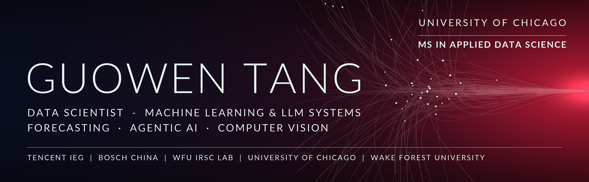

### Data Scientist: ML forecasting, LLM & agentic systems, computer vision | MS in Applied Data Science, University of Chicago

I build machine learning and LLM systems that turn messy data into decisions people actually use, and I care about the last mile: packaging a model so the business can run it without me.

**Most recently at Tencent IEG**, I worked across the game-asset pipeline: SHAP-driven monetization analysis, an AIGC workflow from automated tagging to LoRA-powered image generation, and an SKU-level ARPU forecasting model deployed as a reusable tool for business users. **Before that at Bosch China**, I applied causal discovery to sensor time series for predictive maintenance and worked on an AutoGen-based inventory chatbot. I'm now pursuing an **MS in Applied Data Science at the University of Chicago**, building on a BA in Computer Science and a BS in Mathematical Business from Wake Forest University. I'm seeking **Data Scientist full-time and internship roles**.

---

## Value delivered

**90% less manual labeling.** Automated AI tagging for 102 game assets at Tencent IEG, then trained LoRA models on the tagged assets for downstream AIGC workflows.

**0.01 MAE on SKU-level ARPU forecasting.** Gathered and structured SKU sales data and benchmarked CatBoost and LightGBM. I then packaged the winning model into a reusable prediction tool, so a recurring manual analysis became a decision-support workflow.

**25% better predictive-maintenance accuracy.** Applied causal discovery to multivariate time series from 700+ sensors at Bosch China to surface failure dependencies.

**60% faster query resolution.** Added features and engineered prompts for an AutoGen-based inventory chatbot, integrating retrieval and workflow automation.

**40% faster training pipelines; test coverage from under 10% to 80%.** Optimized PyTorch/TensorFlow training pipelines and expanded backend test coverage for the Ask Bosch platform.

**3,000+ annotated UAV images.** Built a quality-controlled dataset and fine-tuned YOLOv10 for palm-tree detection in dense forest canopies at the WFU IRSC Lab.

---

## How I work

| As a data scientist | As a builder |
| --- | --- |
| Start from the business question, then translate model output (SHAP, causal graphs) into stakeholder recommendations | Benchmark before committing: CatBoost vs. LightGBM, YOLO vs. RT-DETR vs. CLIP |
| Turn one-off analyses into tools business users can run themselves | Reproducible pipelines with scikit-learn `ColumnTransformer` / `Pipeline` and K-Fold CV |
| Interpretability first: SHAP, causal discovery, cluster-selection scoring | LLM systems: RAG, AutoGen multi-agent workflows, prompt engineering, LLM evaluation |
| Check fairness, e.g. survival-model performance across racial groups | Data quality as a feature: imputation pipelines and quality-controlled labeled datasets |
| Tell the story in Tableau and Power BI | Ship and test: deployed forecasting tool, backend coverage from <10% to 80% |

---

## Domains

---

## Stack

**Languages & Data**

**Machine Learning & Deep Learning**

**LLM & Agentic AI**

**Computer Vision**

**Analytics & Visualization**

---

## Selected work

**AIGC workflow (Tencent IEG).** An end-to-end pipeline from asset understanding to controllable image generation: `image tagging → LoRA training → LLM parsing → structured prompt → ComfyUI generation`. Automated tagging cut manual labeling time by 90% across 102 game assets.

**SKU-level ARPU forecasting tool (Tencent IEG).** Structured SKU sales data, benchmarked CatBoost and LightGBM to 0.01 MAE, and packaged the model as an internal prediction service on Tencent Cloud for business users.

**Game-asset monetization drivers (Tencent IEG).** Used SHAP to explain which aesthetic attributes drive monetization, and turned the findings into stakeholder-facing recommendations.

**Causal discovery for predictive maintenance (Bosch China).** Mapped failure dependencies across multivariate time series from 700+ sensors, improving predictive-maintenance accuracy by 25%.

**Inventory chatbot agent (Bosch China).** Built features and engineered prompts on top of an AutoGen multi-agent framework built by teammates, adding retrieval and workflow automation. Query-resolution time fell by 60%.

**UAV palm-tree detection (WFU IRSC Lab).** A deep-learning pipeline for palm-tree detection and spatial analysis in ecological research. I evaluated YOLO, RT-DETR and CLIP, curated 3,000+ annotated UAV images, and fine-tuned YOLOv10 for skeleton prediction in dense canopies.

**Tourist-level clustering (TouringPlans).** Tested whether TouringPlans' 10-level Disney World crowd framework captures real differences in visitor behavior. I applied K-Means and Gaussian Mixture Models, designed a custom cluster-selection score, and presented recommendations in Tableau.

**Equity in post-HCT survival prediction (CIBMTR competition), as team leader.** Built KNN and iterative imputation for heterogeneous clinical data and reproducible scikit-learn feature pipelines. I benchmarked XGBoost, CatBoost and LightGBM with K-Fold CV and a Kaplan-Meier target transformation, and examined performance across racial groups.

*Industry work is described at a high level for confidentiality. No internal data, code, or assets are included in this profile.*

---

## Education

**MS, Applied Data Science — University of Chicago** (Sep 2026 – Aug 2027, expected)

Time Series Analysis · GenAI & Agentic AI Applications · Cloud Native Data Engineering

**BA, Computer Science & BS, Mathematical Business — Wake Forest University** (Aug 2021 – May 2025)

---

## Track record

**Tencent IEG**, Business Analyst Intern, Shenzhen (Oct 2025 – Sep 2026) · **Bosch China**, Strategic Algorithm Intern, Shanghai (Jun – Sep 2025) · **WFU IRSC Lab**, Research Assistant, Winston-Salem (Jan – May 2025)

Projects: **TouringPlans**, Data Analyst · **CIBMTR**, Data Scientist & Team Leader

Across gaming, manufacturing, healthcare, and tourism, my work has been about the same thing: getting from raw data to a model, and from a model to a decision.
